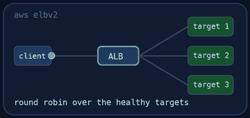
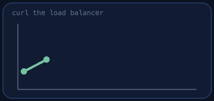
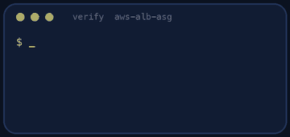
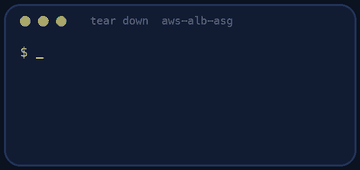

<p align="center"></p>

| | |
|-|-|
| **Time** | 105-120 min |
| **Cost** | a few cents (load balancer and two servers for about an hour) |
| **You need** | An AWS administrator user (the IAM lab), the AWS CLI v2 configured for it, Python 3 and a terminal, curl |

## How this lab works

1. **Fork** this repository to your own GitHub account (button at the top right).
2. Clone **your fork** in your Ubuntu environment (WSL on Windows, your OrbStack machine on Mac).
3. Read the lab below (the same text is in [`LAB.md`](LAB.md)) and follow the mission.
4. Answer the questions in [`SUBMISSION.md`](SUBMISSION.md). Where a question asks for output, paste it in a code block. No screenshots needed.
5. Commit and push. Open the **Actions** tab of your fork (click *I understand my workflows, go ahead and enable them* the first time). The **Lab check** shows what is still missing.
6. When the check is green, **submit the URL of your fork** in the course platform.

> [!NOTE]
> The check only looks at your answers and any files the lab asks you to commit. Your instructor reads your work and may ask you to explain any line.

<p align="center"></p>

## 🎬 The situation

<p align="center"></p>

*The Clippy Dispatch, Black Friday edition. A newsletter for people who keep the short links alive.*

Hello, and welcome. This week's story is a true one, with the names changed to protect the embarrassed.

A big retail customer launched its Black Friday campaign. Every poster, every e-mail and every screen in forty shops carried a Clippy short link. At 08:02 the single server that Clippy lived on ran out of memory, restarted, and was gone for four minutes. Four minutes does not sound like much. It is, if you count it in *customers standing in front of a QR code that says "error"*.

(An aside, because every good newsletter has one: the server was not even busy. It had been running for 214 days and nobody had restarted it since the last time someone said "we should restart it". Servers have feelings too.)

The fix is the oldest trick in the book, and today you build it with your own hands: an **Application Load Balancer** in front of an **Auto Scaling group** of two servers in two availability zones. If one server dies, the balancer stops sending it traffic within seconds, and the group starts a replacement by itself. Then comes the fun part: you kill a server **on purpose** while you watch the URL, and read what happens, second by second.

> [!IMPORTANT]
> **Your mission**
> - Build the chain: security groups, launch template, target group, load balancer, Auto Scaling group, scaling policy
> - Let only the load balancer talk to the servers
> - Terminate a server while you hammer the URL, and read what happens
> - Tear it down (a load balancer bills every hour) and prove it

**Time:** 105-120 min | **Cost:** a few cents (a load balancer and two small servers for about an hour) | **You need:** an AWS administrator user, the AWS CLI v2 configured for it, Python 3, curl and a terminal. The lab uses your default VPC.

<p align="center"></p>

## Part 0 - Before you build: the map

A load balancer feels like one box. It is really three ideas that work together, and most "it does not work" moments come from mixing them up:

- the **listener** accepts a request (port 80 here) and decides what to do with it;
- the **target group** is the list of servers, with a **health check** that decides which of them deserve traffic;
- the **Auto Scaling group** *owns* the servers: it creates them, replaces them and adds more when they sweat.

Who watches whom? The balancer watches the servers (health checks). The group watches the balancer's opinion (health check type **ELB**) and replaces whoever it says is unhealthy. Hold on to that sentence, it comes back in Part 5.

Now the practical part. **Fork** this repository and clone it. `userdata.sh` is the script every new server runs on its first boot: it installs Clippy and sets its `APP_VERSION` to the **instance id**. That means `curl <url>/healthz` tells you *which server answered*. In the console, open **EC2 → Load Balancers** and **EC2 → Auto Scaling Groups** to see the screens you will fill in. You will do the work in the console first and write the CLI commands in `notes.md` as you go.

> [!NOTE]
> **Predict** Two servers, one load balancer. You send 10 requests in a row and print the `version` of each answer. What do you expect to see: all the same, alternating, or random? Write it down now, you will check in Part 4.

> [!NOTE]
> **Think** The servers have no public address in your design (only the load balancer is reachable). Yet they must download packages from the internet at boot. In the default VPC they do have public IPs; in a real VPC what would give them internet access, and what would that cost?

<p align="center"></p>

## Part 1 - Two security groups: who may knock on which door

Create two security groups in the default VPC, both tagged `lab = aws-alb-asg`:

| Name | Inbound rule |
|------|--------------|
| `clippy-alb` | port 80 from `0.0.0.0/0` |
| `clippy-web` | port 80 **from the security group `clippy-alb`** (not from a CIDR) |

> [!NOTE]
> **Predict** After this lab, you find a server's public IP and run `curl http://<that-ip>`. Does it answer? Why, or why not? Test it at the end of Part 4.

> [!NOTE]
> **Think** Why does the second rule name a *security group* as the source? What stops somebody from calling a server directly if they discover its public IP?

<p align="center"></p>

## Part 2 - Launch template and target group: the recipe and the guest list

1. **Launch template** `clippy-web`: Ubuntu 24.04 (the AMI id comes from the public parameter `/aws/service/canonical/ubuntu/server/24.04/stable/current/amd64/hvm/ebs-gp3/ami-id`), `t3.micro`, security group `clippy-web`, **IMDSv2 required**, the contents of `userdata.sh` as user data, and the instance tags `lab = aws-alb-asg` and `Name = clippy-web`.
2. **Target group** `clippy-web`: HTTP port 80 in the default VPC, health check path `/healthz`, interval 10 seconds, healthy threshold 2, unhealthy threshold 2, timeout 5.

> [!NOTE]
> **Think** The health check path is `/healthz`, not `/`. Clippy also has `/readyz`. What would each choose to report if the database were down, and which one should a load balancer use?

<p align="center"></p>

## Part 3 - The load balancer: the front door

Create an **Application Load Balancer** `clippy-alb`: internet-facing, security group `clippy-alb`, **one public subnet in each of at least two availability zones**, and a listener on port 80 that forwards to the target group. Note its DNS name.

> [!NOTE]
> **Predict** The balancer exists, but the target group is empty. What does `curl http://<dns-name>` return right now? (Try it. Reading an error message you predicted is a small pleasure.)

<p align="center"></p>

## Part 4 - The Auto Scaling group: the team that replaces itself

Create the group `clippy-web` from the launch template:

- minimum **2**, desired 2, maximum **4**, in subnets of **two availability zones**;
- attached to the target group;
- health check type **ELB**, and a **grace period of 300 seconds**;
- a **target tracking** scaling policy on average CPU utilization, target 50%.

Wait for the targets to become `healthy` (the servers take two to four minutes to install Clippy):

```bash
TG=$(aws elbv2 describe-target-groups --names clippy-web --query 'TargetGroups[0].TargetGroupArn' --output text)
aws elbv2 describe-target-health --target-group-arn $TG --query 'TargetHealthDescriptions[].[Target.Id,TargetHealth.State]' --output text
DNS=$(aws elbv2 describe-load-balancers --names clippy-alb --query 'LoadBalancers[0].DNSName' --output text)
for i in 1 2 3 4 5 6; do curl -s http://$DNS/healthz; echo; done
```

The `version` field changes: the balancer is spreading requests over two servers. Compare with your prediction from Part 0, and try the direct-IP `curl` from Part 1 now.

> [!NOTE]
> **Think** Why 300 seconds of grace? Find out for yourself: what happens to a server that needs four minutes to install Clippy if the grace period is 120 seconds and the health check type is ELB? (If you see a server being terminated and relaunched in a loop, you found it.)

<p align="center"></p>

## Part 5 - The main event: kill a server on purpose

<p align="center"></p>

In one terminal, hit the URL five times a second:

```bash
while true; do for i in 1 2 3 4 5; do curl -s -o /dev/null -m 3 -w '%{http_code} ' http://$DNS/healthz; done; date +%T; sleep 1; done
```

> [!NOTE]
> **Predict** You are about to terminate one of two servers. Before you do, write down: will you see errors? For how many seconds? What will the *first* error code be, `502`, `503` or `000`?

In another terminal, terminate one of the servers (console, or `aws ec2 terminate-instances`). Watch the first terminal and then the group's activity:

```bash
aws autoscaling describe-scaling-activities --auto-scaling-group-name clippy-web --max-items 5 --query 'Activities[].[Description,Cause]' --output text
```

You will probably see a few errors (`502` or `000`) for several seconds, then only `200`, then, a few minutes later, a replacement joins.

> [!NOTE]
> **Think** Why were there errors at all? Multiply the health check interval by the unhealthy threshold: that is how long the balancer keeps sending traffic to a dead server. How would you shrink that window, and what would you pay for it (more health check traffic, more false alarms)?

Here is the part the newsletter likes best. Look at your own timeline and fill in four numbers in `notes.md`: when you terminated the server, when the first error appeared, when the last error appeared, and when the replacement became `healthy`. Three delays add up (the balancer notices, the group reacts, the new server boots), and none of them is zero.

<p align="center"></p>

## Part 6 - Prove it

<p align="center"></p>

```bash
./verify.sh
```

It reads the real load balancer, target group, group, policies and security groups, sends 20 requests, checks they were answered by at least two different servers, and looks for the terminated-and-replaced server in the activity history. Fix what is red and run it again until it ends with **ALL CHECKS PASSED**.

> [!TIP]
> **Stuck?** Targets stay `unhealthy`: read the reason in `describe-target-health`, check the security group on the servers and give the user data time. `unhealthy` forever with `Request timed out`: the `clippy-web` group must allow port 80 from the `clippy-alb` group. A server keeps being replaced: the grace period is shorter than the install time. `DNS name not found` for the first minute is normal.

<p align="center"></p>

## Level up (optional)

- Generate load (`ab`, `hey` or a loop with `xargs -P`) until CPU crosses 50% and watch the group grow to three or four servers. Then stop and watch it shrink.
- Add an HTTPS listener with a certificate from ACM and redirect port 80 to it.
- Replace the launch template user data with a pre-baked image (an AMI) and compare the time to replace a server.
- Turn on access logs for the load balancer to an S3 bucket and find your own `curl` in them.

*That is the issue. Next week: what to do when the load balancer is the thing that dies. (Spoiler: you do not ask it nicely.)*

<!-- teardown:start (generated by labs.py, do not edit) -->
## Tear down (mandatory)

<p align="center"></p>

Resources left behind cost money, keep doors open and pollute the next lab. Removing what you created is part of the job, so it is part of the submission: **you must prove it is gone**.

Do this **last**, after you have pasted your `verify` output into `SUBMISSION.md` (once you tear down, the lab can no longer be verified).

1. Run `./teardown.sh`. It deletes the Auto Scaling group, the load balancer, the target group, the launch template and the security groups. Then run `./verify-teardown.sh`.

Then run the proof:

```bash
./verify-teardown.sh
```

It prints a list of checks and must end with **TEARDOWN VERIFIED**. If it reports leftovers, remove them and run it again. Paste the full output in your submission.
<!-- teardown:end -->

<!-- submission:start (generated by labs.py, do not edit) -->
## 📬 Submission

Answer the questions in `SUBMISSION.md` in **your fork** (paste output in code blocks where asked), push, then submit the **URL of your fork**.

**Files to commit**

- `notes.md` with your commands and what you saw (optional)

**Questions to answer**

1. Paste the target group health check settings and the state of the targets (`aws elbv2 describe-target-health`). Why does the health check use `/healthz` and not `/`?
2. Terminate one server on purpose and paste the Auto Scaling activity history and a loop of `curl` against the load balancer during the replacement. Did any request fail? What decides how many?
3. Show the security groups: why does the instance group allow port 80 from the load balancer's group and not from the world?
4. Paste the target tracking policy. What happens to the number of servers when CPU goes above the target for a few minutes, and what stops it growing forever?
5. What is the difference between the load balancer health check and the Auto Scaling health check type (`EC2` or `ELB`)? Which did you choose and why?
6. Paste the output of `./verify.sh`. It must end with **ALL CHECKS PASSED**.
7. **Tear down.** Paste the output of `./verify-teardown.sh`. It must end with **TEARDOWN VERIFIED**.
<!-- submission:end -->
